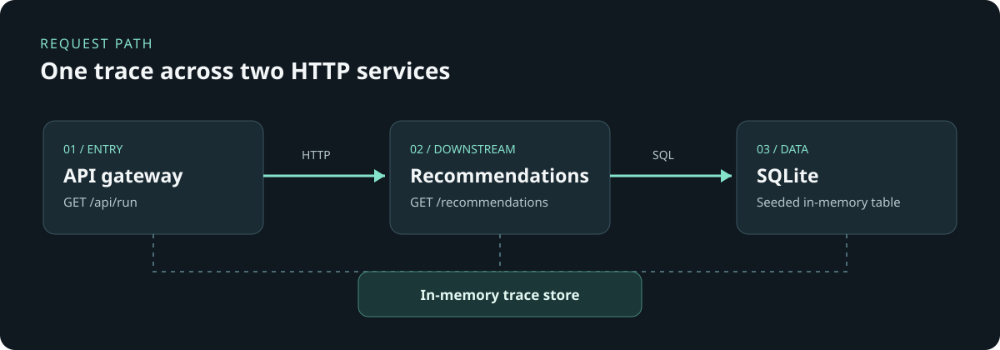

# Incident Replay

**A request tracing lab for finding the layer where a backend symptom began.**



Run the Python server locally to record HTTP requests between its two services
and query the seeded SQLite database. Opening the static HTML alone shows
deterministic sample traces.

## What it does

Choose one of four scenarios and follow a request through the API gateway,
recommendation service, and SQLite query:

| Scenario | Response | What the trace reveals |
| --- | --- | --- |
| Healthy | 200, three recommendations | Baseline timings across services |
| Slow database | 200, three recommendations | A deliberately slow database span |
| Database failure | 502 from gateway | Downstream 503 and failed database span |
| Silent empty result | 200, zero recommendations | An application failure despite HTTP success |

The viewer shows parent/child spans, duration, service, status, and a detail
panel for each step. The silent empty case is deliberate: transport success
alone does not mean the user received a working feature.

## Screenshots

Capture the **Database failure** and **Silent empty result** scenarios from
the running local services:

```bash
python3 -m pip install playwright
python3 -m playwright install chromium
python3 scripts/capture_screenshots.py
```

The script launches temporary loopback servers and writes both full-page images
to `docs/screenshots/`. Their trace mode label reads **RECORDED LOCAL HTTP TRACE**.
Screenshot capture is optional; the application itself has no third-party
dependencies. The architecture image above is included in the repository.

## Run locally

Requires Python 3.11+ and no third-party packages.

```bash
python3 server.py
```

Open `http://127.0.0.1:8002` and click **Run scenario**. The gateway runs on
port 8002 and the downstream service on port 8003. Both are separate HTTP
servers started in one process for easy setup. The UI uses the real local API
when the Python server is running.

The API endpoints are `/api/run?fault=healthy|slow|database|empty`,
`/api/traces`, and `/api/traces/<id>`. Recent traces are held in memory and
cleared on restart.

## Test

```bash
python3 -m unittest discover -v
```

The end-to-end tests run both services on temporary loopback ports and verify
cross-service spans, the explicit 502 path, the 200-with-empty-result path,
and trace retrieval. GitHub Actions runs them on Python 3.11 and 3.12.

## Architecture and tradeoff

The gateway passes a trace ID and parent span ID over HTTP. The downstream
service queries a seeded in-memory SQLite database. A thread-safe
in-memory store groups child spans by request. This makes the debugging path
visible without requiring a telemetry backend, but traces do not survive a
restart. The span model and headers are **not OpenTelemetry wire protocol**;
using an OpenTelemetry SDK and collector would be the next interoperability
step. The database failure, latency, and empty-result filter are injected
scenarios, not production incidents.
